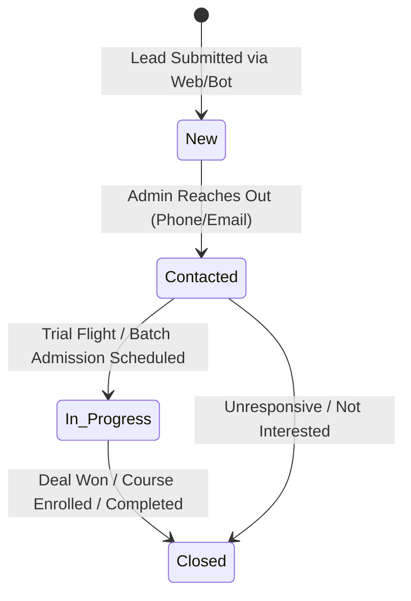

# DroneTV AI Support & Lead Assistant — Database Schema Documentation

## 1. Overview
The **DroneTV Platform** uses **MongoDB** as its persistent document database, managed via **Mongoose ODM**. It also includes an automated, zero-configuration in-memory MongoDB fallback (`mongodb-memory-server`) to ensure instant evaluation and execution on any developer workstation or testing environment without requiring an external MongoDB service.

---

## 2. Collection: `enquiries`

The `enquiries` collection stores leads generated from:
1. Public interactive lead forms on the website
2. AI chatbot conversational triggers (when a user mentions student courses or commercial services)
3. Direct enquiry forms on the contact page

### Document Schema Definition

| Field Name | Type | Required | Default | Validation & Rules | Description |
| :--- | :--- | :---: | :--- | :--- | :--- |
| `_id` | `ObjectId` | Yes | Auto (MongoDB) | Unique 24-character hex identifier | Primary key for the lead document |
| `name` | `String` | Yes | — | `minlength: 2`, `maxlength: 100`, `trim: true` | Full name of the candidate or client |
| `email` | `String` | Yes | — | Valid email regex `^\S+@\S+\.\S+$`, `lowercase: true`, `trim: true` | Contact email address |
| `phone` | `String` | Yes | — | Regex `^[\d\+\-\s\(\)]{7,20}$`, `trim: true` | Contact phone number with country code |
| `userType` | `String` | Yes | `'Customer'` | `enum: ['Student', 'Customer', 'Other']` | Submitter categorization |
| `interest` | `String` | Yes | — | `maxlength: 200`, `trim: true` | Service or Course of interest |
| `message` | `String` | Yes | — | `maxlength: 2000`, `trim: true` | Additional details or question body |
| `status` | `String` | Yes | `'New'` | `enum: ['New', 'Contacted', 'In Progress', 'Closed']` | Workflow lifecycle status |
| `adminNotes` | `String` | No | `''` | `maxlength: 2000`, `trim: true` | Internal team remarks & follow-up log |
| `createdAt` | `Date` | Yes | Auto | Timestamp of lead capture | Automated ISO date timestamp |
| `updatedAt` | `Date` | Yes | Auto | Timestamp of latest modification | Automated ISO date timestamp |

---

## 3. Database Indexes

To support rapid search, filtering, and high-performance querying in the Admin Dashboard, the following indexes are applied:

```javascript
// Index on status for status-based filtering (New, Contacted, In Progress, Closed)
enquirySchema.index({ status: 1 });

// Index on userType for role segmentation (Student, Customer)
enquirySchema.index({ userType: 1 });

// Descending index on creation date for reverse-chronological pagination
enquirySchema.index({ createdAt: -1 });

// Compound text index for full-text search across multiple fields
enquirySchema.index({
  name: 'text',
  email: 'text',
  phone: 'text',
  interest: 'text',
  message: 'text'
});
```

---

## 4. Status Lifecycle State Machine



- **`New`**: Lead created via website or chatbot; awaiting initial review.
- **`Contacted`**: Team has initiated contact via phone call, WhatsApp, or email.
- **`In Progress`**: Active negotiations, quotation sent, or entrance admission in progress.
- **`Closed`**: Admission finalized, service agreement executed, or ticket resolved.

---

## 5. MongoDB `$jsonSchema` Validation Specification

```json
{
  "$jsonSchema": {
    "bsonType": "object",
    "required": ["name", "email", "phone", "userType", "interest", "message", "status"],
    "properties": {
      "_id": { "bsonType": "objectId" },
      "name": {
        "bsonType": "string",
        "minLength": 2,
        "maxLength": 100,
        "description": "Full name of candidate/customer (2-100 characters)"
      },
      "email": {
        "bsonType": "string",
        "pattern": "^\\S+@\\S+\\.\\S+$",
        "description": "Valid email address format"
      },
      "phone": {
        "bsonType": "string",
        "pattern": "^[\\d\\+\\-\\s\\(\\)]{7,20}$",
        "description": "Valid phone number with 7-20 digits and optional formatting symbols"
      },
      "userType": {
        "enum": ["Student", "Customer", "Other"],
        "description": "Classification of the submitter"
      },
      "interest": {
        "bsonType": "string",
        "maxLength": 200,
        "description": "Service or course title of interest"
      },
      "message": {
        "bsonType": "string",
        "maxLength": 2000,
        "description": "Enquiry details or question text"
      },
      "status": {
        "enum": ["New", "Contacted", "In Progress", "Closed"],
        "description": "Workflow lifecycle status of lead"
      },
      "adminNotes": {
        "bsonType": "string",
        "maxLength": 2000,
        "description": "Internal team comments and log history"
      },
      "createdAt": { "bsonType": "date" },
      "updatedAt": { "bsonType": "date" }
    }
  }
}
```

---

## 6. Sample Documents

### Sample 1: Student DGCA Pilot Enquiry
```json
{
  "_id": "6614a8b7e4b0123456789001",
  "name": "Kavya Reddy",
  "email": "kavya.reddy@example.com",
  "phone": "+91 98480 22334",
  "userType": "Student",
  "interest": "DGCA Certified Drone Pilot Training",
  "message": "I am a graduate looking to obtain a commercial pilot license. What are the upcoming batch dates and fee concessions?",
  "status": "New",
  "adminNotes": "",
  "createdAt": "2026-10-09T10:15:30.000Z",
  "updatedAt": "2026-10-09T10:15:30.000Z"
}
```

### Sample 2: Enterprise Agriculture Customer
```json
{
  "_id": "6614a8b7e4b0123456789002",
  "name": "Rajesh Varma",
  "email": "rajesh.varma@agritech.in",
  "phone": "+91 99887 76655",
  "userType": "Customer",
  "interest": "Precision Agriculture & Crop Spraying",
  "message": "We have 150 acres of sugarcane and paddy farmland requiring multispectral health mapping and automated spraying.",
  "status": "Contacted",
  "adminNotes": "Spoke on phone on Oct 9. Sent commercial pricing matrix and drone payload specs.",
  "createdAt": "2026-10-08T14:22:10.000Z",
  "updatedAt": "2026-10-09T11:00:00.000Z"
}
```

---

## 7. TypeScript Entity Interface (`server/src/models/Enquiry.ts`)

```typescript
export type UserType = 'Student' | 'Customer' | 'Other';
export type EnquiryStatus = 'New' | 'Contacted' | 'In Progress' | 'Closed';

export interface IEnquiry {
  _id?: string;
  name: string;
  email: string;
  phone: string;
  userType: UserType;
  interest: string;
  message: string;
  status: EnquiryStatus;
  adminNotes?: string;
  createdAt?: Date;
  updatedAt?: Date;
}
```
